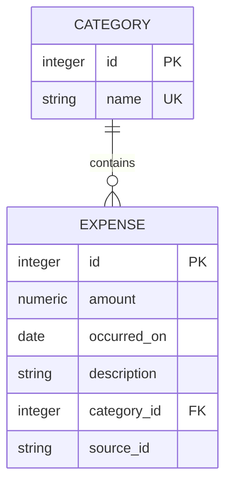

## Week 2 PostgreSQL Assignment
# question 1: 
Explain DBMS, RDBMS, PostgreSQL and SQL using the organization expense scenario. Identify server, database,schema, table, row and column. State how persistent tables differ from a JSON file.

answer:
# Q01 — Database Foundations

A Database Management System (DBMS) is software used to create, store, retrieve, update, and manage data. A Relational Database Management System (RDBMS) is a type of DBMS that stores data in tables and establishes relationships using keys. PostgreSQL is an open-source RDBMS that supports SQL, transactions, constraints, and indexing. SQL (Structured Query Language) is used to create database objects and query or modify their data.

In the organization expense-management scenario, the PostgreSQL server runs the database service. The `org_expenses` database stores the application's data, and the `org` schema organizes related objects. The `employees` table stores employee records. Each employee record is a row, while attributes such as `employee_id`, `full_name`, and `email` are columns.

PostgreSQL tables differ from JSON files because PostgreSQL can enforce relational constraints, perform joins and aggregations using SQL, and manage concurrent transactions. JSON files are useful for lightweight storage and data exchange, but relational integrity and concurrent modifications must be handled separately by the application.

Example SQL query:

`SELECT employee_id, full_name, email FROM org.employees;`

This query retrieves employee IDs, names, and email addresses from the employees table.


# question 2:
Describe external, conceptual and internal schemas. Map a finance report, the entity model and an index to the
appropriate levels. Give one example each of logical and physical data independence; distinguish these levels from a
PostgreSQL schema namespace.
Submit A three-level diagram and a short explanation.

answer:
# Q02 — Three-Schema Architecture

The three-schema architecture separates a database into external, conceptual, and internal levels.

1. External schema: Describes how individual users or applications view the data. For example, a finance report displays employee names, expense categories, dates, amounts, and approval statuses.

2. Conceptual schema: Describes the overall logical database design, including entities, attributes, relationships, and constraints. For example, the organization expense system's ER model defines relationships between employees, departments, categories, projects, and expenses.

3. Internal schema: Describes how the database stores and accesses data, including indexes and storage structures. For example, an index on `org.expenses(employee_id, occurred_on)` can improve the performance of employee expense searches.

Logical data independence allows changes to the conceptual design without requiring changes to unaffected external views or applications. For example, adding an optional receipt reference should not affect a report that does not use it.

Physical data independence allows changes to physical storage or access methods without changing the logical design or application queries. For example, adding an index can improve query performance without changing the table structure.

The three-schema architecture must be distinguished from a PostgreSQL schema namespace. A PostgreSQL schema, such as `org`, organizes database objects within a database; it is not itself one of the three architectural levels.

Diagram: External level (finance report) ↕ Conceptual level (ER model and relationships) ↕ Internal level (indexes and storage structures).

## question 3:
Draw the ER diagram for the seven initial tables in the data contract. Mark primary/foreign keys, optional
relationships, one-to-one profiles, one-to-many expenses, the many-to-many project junction and the manager self
relationship. List five business rules.

answer:


## question 4:
Use employees and employee_projects to distinguish superkey, candidate, primary, alternate, natural, surrogate,
composite and foreign keys. Under the contract, identify every employee candidate key and explain why a
nonminimal superkey is not a candidate key.

answer:
# Q04 — Key Classification

A superkey is any column or combination of columns that uniquely identifies a row. A candidate key is a minimal superkey, meaning no attribute can be removed without losing uniqueness. A primary key is the candidate key selected as the main identifier, while alternate keys are the remaining candidate keys.

In the `employees` table, `employee_id` is a surrogate key because it is generated for database identification. `employee_code` and normalized `email` are natural keys because they represent meaningful employee attributes. Under the assignment's uniqueness and non-null requirements, all three are candidate keys. If `employee_id` is selected as the primary key, `employee_code` and `email` are alternate keys.

A composite key contains multiple columns. In `employee_projects`, `(employee_id, project_id)` forms a composite primary key that prevents duplicate employee-project assignments. Both columns are also foreign keys referencing `employees` and `projects`, respectively.

A foreign key establishes a relationship between tables. For example, `employees.department_id` references `departments.department_id`, while `employees.manager_id` references `employees.employee_id`.

Every candidate key is a superkey, but not every superkey is a candidate key. For example, `(employee_id, full_name)` is a superkey, but it is not minimal because `employee_id` alone uniquely identifies an employee.

Therefore, the employee candidate keys are `employee_id`, `employee_code`, and normalized `email`, assuming the uniqueness and non-null constraints specified in the assignment.


## question 5:
For R(employee_id, email, department_id, department_name), use F = {employee_id -&gt; email, department_id;
email -&gt; employee_id; department_id -&gt; department_name}. Compute employee_id+, email+ and department_id+
step by step. Find all candidate keys and justify minimality.

answer:
## Q05 — Attribute Closure and Candidate Keys

Given relation:

R(employee_id, email, department_id, department_name)

Functional dependencies:

- employee_id → email, department_id
- email → employee_id
- department_id → department_name

### 1. Closure of employee_id

Start with employee_id⁺ = {employee_id}.

Using employee_id → email, department_id, add email and department_id.

Using department_id → department_name, add department_name.

Therefore:

employee_id⁺ = {employee_id, email, department_id, department_name}

### 2. Closure of email

Start with email⁺ = {email}.

Using email → employee_id, add employee_id.

Using employee_id → email, department_id, add department_id.

Using department_id → department_name, add department_name.

Therefore:

email⁺ = {email, employee_id, department_id, department_name}

### 3. Closure of department_id

Start with department_id⁺ = {department_id}.

Using department_id → department_name, add department_name.

No other functional dependency can be applied to determine employee_id or email.

Therefore:

department_id⁺ = {department_id, department_name}

### 4. Candidate keys and minimality

The candidate keys are employee_id and email because the closure of each contains all four attributes in the relation. Each is a single attribute, so neither has a proper nonempty subset that could be a key. Neither can be removed from the candidate-key list because they are distinct minimal attribute sets.

department_id is not a candidate key because its closure does not contain employee_id or email. Any larger set containing employee_id or email is nonminimal because that single attribute already determines all attributes.

**Final answer:** The candidate keys are {employee_id} and {email}.


## question 6:
For ExpenseExport(expense_id, employee_id, employee_name, department_id, department_name, category_id,
category_name, amount), assume expense_id determines all fields, employee_id determines employee_name and
department_id, department_id determines department_name, and category_id determines category_name.
Explain anomalies and normalize through 1NF, 2NF and 3NF. Check BCNF for the resulting relations under only these dependencies.

answer:
## Q06 — Normalization

Original relation:

ExpenseExport(expense_id, employee_id, employee_name, department_id, department_name, category_id, category_name, amount)

Functional dependencies:

- expense_id determines all attributes.
- employee_id → employee_name, department_id
- department_id → department_name
- category_id → category_name

### 1. Anomalies

- **Update anomaly:** Employee or department details must be updated in multiple expense rows, which can cause inconsistent data.
- **Deletion anomaly:** Deleting an expense may accidentally remove the only stored information about a category.
- **Insertion anomaly:** Employee or category information cannot be conveniently stored independently of an expense.

### 2. First Normal Form (1NF)

The relation satisfies 1NF when every column contains atomic values and there are no repeating groups or lists within a cell. The example relation can satisfy 1NF if its values are atomic.

Atomicity alone does not prove that a relation is in 3NF.

### 3. Second Normal Form (2NF)

The relation is in 2NF if it is in 1NF and every non-key attribute depends on the whole candidate key. Since expense_id is a single-attribute candidate key, no partial dependency on a proper subset of that key is possible.

Therefore, the original relation satisfies 2NF under the stated assumptions.

### 4. Decomposition into 3NF

Decompose the relation into:

1. Employees(employee_id, employee_name, department_id)
2. Departments(department_id, department_name)
3. Categories(category_id, category_name)
4. Expenses(expense_id, employee_id, category_id, amount)

Primary keys are employee_id, department_id, category_id and expense_id, respectively. Employees.department_id references Departments.department_id. Expenses.employee_id references Employees.employee_id, and Expenses.category_id references Categories.category_id.

This decomposition removes the transitive dependencies employee_id → department_id → department_name and prevents employee, department and category details from being unnecessarily repeated across expense records.

### 5. BCNF check

A relation is in BCNF when the determinant of every non-trivial functional dependency is a superkey.

In Employees, employee_id is a key; in Departments, department_id is a key; in Categories, category_id is a key; and in Expenses, expense_id is a key. Therefore, every non-trivial dependency in the resulting relations has a superkey as its determinant.

Thus, all four relations satisfy BCNF under only the given dependencies.

### 6. Lossless-join reasoning

The decomposition retains the identifying keys and uses foreign keys to connect employees with departments and expenses with employees and categories. Each decomposition follows the supplied functional dependencies and retains the determinant in the relevant relation. Therefore, the decomposition is lossless under the given dependencies.

## question 7:
Install or use the mentor-provided PostgreSQL environment. Record SELECT version(), connect using psql or
pgAdmin, and create a dedicated org_expenses database and org schema. Explain why CREATE DATABASE runs
separately from a transaction block.

answer:
1. PostgreSQL version
   The installed PostgreSQL version is PostgreSQL 18.6. I verified the version using `SELECT version();` in the VS Code SQL query editor.

2. Connection steps:
   1. Opened the PostgreSQL database extension in VS Code.
   2. Connected to the local PostgreSQL server at `127.0.0.1:5432`.
   3. Connected to the existing `postgres` database.
   4. Executed `CREATE DATABASE org_expenses;` to create the dedicated project database.
   5. Connected to `org_expenses` and created the `org` schema using `CREATE SCHEMA org;`.
   6. Verified the current database and confirmed that the `org` schema exists.

3. Why CREATE DATABASE runs separately

   PostgreSQL does not allow `CREATE DATABASE` inside a transaction block. Therefore, it must be executed as a standalone statement. After creating the database, I connect to it before creating the schema and tables.

## question-8
Create departments, categories and projects in dependency order. Choose identity keys and suitable PostgreSQL types; add required names, uniqueness and the project department foreign key. Explain one reason to choose DATE,TIMESTAMPTZ and NUMERIC in this system.

answer:
### Q08. Parent Tables and Data Types

Created the following tables in the `org` schema in dependency order:

1. `org.departments` — contains department IDs and unique department names.
2. `org.categories` — contains category IDs and unique category names.
3. `org.projects` — contains project IDs, unique project names, and a required foreign key referencing `org.departments(department_id)`.

Data-type justifications:

- DATE: Suitable for hiring dates and expense occurrence dates because these fields require a calendar date without a time of day.
- TIMESTAMPTZ: Suitable for `updated_at` because it represents a specific instant in time and supports consistent handling across time zones.
- NUMERIC(12,2): Suitable for expense amounts because it provides exact decimal storage for monetary values, avoiding floating-point rounding approximations.

## question-9
Create employees and employee_profiles. Implement required and optional foreign keys, alternate keys and the one-to-one profile design. Prevent direct self-management with a row CHECK. Explain why that CHECK does not prevent longer manager cycles.

answers:
### Q09. Employee Relationships

Created `org.employees` and `org.employee_profiles` with the required keys and constraints.

1. Employee relationships

- `employee_id` is an identity primary key.
- `employee_code` and `email` are separate `UNIQUE NOT NULL` alternate keys.
- `department_id` is a required foreign key referencing `org.departments(department_id)`.
- `manager_id` is an optional self-referencing foreign key to `org.employees(employee_id)`.

2. One-to-one employee profile

In `org.employee_profiles`, `employee_id` is both the primary key and a foreign key referencing `org.employees(employee_id)`. This ensures that each profile belongs to an existing employee and that an employee can have at most one profile. The employee may exist without a profile.

3. Preventing direct self-management

The constraint `chk_employee_not_own_manager` uses:

`CHECK (manager_id IS NULL OR manager_id <> employee_id)`

This rejects a row where an employee's manager ID equals their own employee ID.

4. Limitation of the CHECK constraint

A row-level `CHECK` constraint prevents direct self-management but does not prevent longer management cycles involving multiple employees. For example, employee A could report to B while B reports to A. Preventing such cycles requires additional logic, such as a trigger or application-level validation.

5. Verification

Inserted a department, two employees, and an employee profile. Verified the manager relationship and profile using `SELECT` queries. Tested the self-management constraint with an `UPDATE` that attempted to make an employee their own manager; PostgreSQL should reject this operation with a check-constraint violation.


## question 10:
Create expenses and employee_projects using the contract. Implement a positive required amount, valid status,required dates and the composite junction key. Choose and explain delete actions for each foreign key; retainemployees referenced by expenses.

answers:
### Q10. Expenses and Junction Table

Created `org.expenses` and `org.employee_projects`.

1. Expenses table

- `expense_id` is an identity primary key.
- `employee_id` and `category_id` are required foreign keys.
- `amount` uses `NUMERIC(12,2) NOT NULL` with `CHECK (amount > 0)`.
- `occurred_on` uses `DATE NOT NULL`.
- `status` defaults to `draft` and permits only `draft`, `submitted`, `approved` or `rejected`.
- `updated_at` uses `TIMESTAMPTZ` and defaults to `CURRENT_TIMESTAMP`.

2. Employee–project junction table

- `employee_projects` connects employees and projects in a many-to-many relationship.
- The composite primary key `(employee_id, project_id)` prevents duplicate assignments.
- Both foreign keys use `ON DELETE CASCADE`, so deleting a parent removes its related assignment rows.
- `assigned_on` is a required date with a default of `CURRENT_DATE`.

3. Delete actions

The employee and category foreign keys in `org.expenses` use `ON DELETE RESTRICT`. This protects expense history by preventing deletion of an employee or category that is referenced by an expense. The junction table uses `ON DELETE CASCADE` because assignments should be removed when their employee or project is deleted.

4. Verification

Inserted a valid travel expense and a valid employee–project assignment. Tested the positive-amount and allowed-status constraints, and tested the composite primary key by attempting a duplicate assignment. PostgreSQL should reject all three invalid operations.

Verified the valid expense and assignment using `SELECT` queries.

## question 11:
Create deterministic synthetic seed SQL meeting every minimum and edge case in the data contract. Insert parents before children and managers before their reports. Record baseline row counts and totals; do not hard-code assumptions about identity values.

answer:
## Q11. Seed a Useful Dataset

Objective: Create deterministic synthetic seed data in PostgreSQL to test the organization expense database, including normal records and required edge cases.

### Implementation

Created `02_seed.sql` to insert seed data into the `org` schema. Parent records were inserted before dependent records, and managers were inserted before their reports. The script uses conflict-handling logic to reduce duplicate records when it is rerun.

The dataset includes departments, employees, employee profiles, categories, projects, project assignments, and expenses. The expense records use valid positive amounts, valid foreign-key relationships, lowercase email addresses, and dates spanning July, August, and September 2026.

### Dataset verification

| Table | Verified row count |
|---|---:|
| Departments | 5 |
| Employees | 14 |
| Employee profiles | 7 |
| Categories | 7 |
| Projects | 5 |
| Employee-project assignments | 15 |
| Expenses | 41 |

These totals include the existing records preserved in the database, in addition to the synthetic seed data.

### Edge cases verified

- A department with no employees.
- At least two employees with no expenses.
- A category with no expenses.
- An employee-manager hierarchy with at least three levels.
- An employee assigned to multiple projects.
- An employee without a project assignment.
- Expenses with `NULL` descriptions.
- All four statuses: `draft`, `submitted`, `approved`, and `rejected`.
- Categories satisfying the required submitted/approved total and status combinations.
- Tied employee monthly expense totals for ranking exercises.
- Amounts on both sides of the selected ₹100 and ₹1,000 band boundaries.

### Baseline recording

Executed verification queries to record table row counts, the overall expense count and total amount, the earliest and latest expense dates, and expense totals by category. These baseline results were captured before temporary experiments.

Overall expense count: 41 rows  
Overall expense amount: [Enter the exact total from the baseline query]  
Earliest expense date: [Enter the date from the baseline query]  
Latest expense date: [Enter the date from the baseline query]

The per-category counts and totals were obtained using a `LEFT JOIN` between `org.categories` and `org.expenses`, with `COALESCE` used to display zero totals for categories without expenses.

### Conclusion

The seed dataset was inserted and verified successfully against the required minimum row counts and edge cases. The SQL script and baseline verification queries are saved in `02_seed.sql`. Existing database records were preserved throughout the process.

## question 12:
Demonstrate rejection of a duplicate email, missing name, nonpositive amount, invalid status, missing parent and duplicate project assignment. Explain why CHECK(amount &gt; 0) alone allows NULL. Run expected failures in isolated transactions or savepoints.

answer:
### Objective

To verify that PostgreSQL constraints reject invalid data while accepting valid data.

### Test Cases and Results

Test 1: Duplicate employee email
- Expected result: Rejected.
- Reason: The UNIQUE constraint prevents duplicate email addresses.

Test 2: Missing employee name
- Expected result: Rejected.
- Reason: The NOT NULL constraint requires a full name.

Test 3: Nonpositive expense amount
- Expected result: Rejected.
- Reason: The CHECK constraint requires the amount to be greater than zero.

Test 4: Invalid expense status
- Expected result: Rejected.
- Reason: The status constraint does not allow the value `pending`.

Test 5: Missing category parent
- Expected result: Rejected.
- Reason: The foreign-key constraint prevents an expense from referencing a category that does not exist.

Test 6: Duplicate project assignment
- Expected result: Rejected.
- Reason: The primary-key or unique constraint prevents duplicate employee-project assignments.

Test 7: Valid control case
- Expected result: Accepted.
- Reason: The expense amount of 51.00 and status `draft` satisfy the required constraints. The transaction was rolled back afterward to preserve the original data.

### Why does CHECK (amount > 0) alone allow NULL?

In PostgreSQL, a CHECK constraint rejects a row when its condition evaluates to FALSE. When `amount` is NULL, the expression `amount > 0` evaluates to NULL (unknown), not FALSE. Therefore, the CHECK constraint alone allows NULL values.

To prevent both NULL and nonpositive amounts, define the column as follows:

## amount NUMERIC(10, 2) NOT NULL CHECK (amount > 0)

The NOT NULL constraint prevents missing amounts, while the CHECK constraint rejects zero and negative amounts.

### Recovery Steps

Each rejected test was executed inside a transaction. After PostgreSQL reported an error, ROLLBACK was executed separately to recover from the failed transaction. The valid control test was also rolled back after confirming that the insert succeeded.

### Conclusion

All six invalid operations were rejected by the appropriate constraints, while the valid control insert succeeded. Transactions and rollbacks prevented the tests from permanently changing the project data.

## question 13:
List employee code, name and email for active employees hired before 2026-07-01. Sort by name then
employee_id; return the first five. Explain WHERE, projection, ORDER BY and LIMIT.

answer:
## Q13. Read and Filter

### SQL Query

```sql
SELECT
    employee_code,
    full_name,
    email
FROM org.employees
WHERE is_active = TRUE
  AND hired_on < DATE '2026-07-01'
ORDER BY full_name, employee_id
LIMIT 5;
```

### Explanation

1. WHERE

The WHERE clause filters employees based on the specified conditions. It selects only active employees whose hiring date is earlier than July 1, 2026.

2. Projection

Projection means selecting specific columns from a table. Here, `employee_code`, `full_name`, and `email` are selected instead of displaying every column.

3. ORDER BY

The ORDER BY clause sorts the results by `full_name` first and `employee_id` second. The default sorting order is ascending.

4. LIMIT

The LIMIT clause restricts the output to a maximum of five rows.

### Conclusion

This query demonstrates how PostgreSQL retrieves specific columns, filters rows using conditions, sorts the results, and limits the number of returned records. It does not modify the database.


## question 14:
Find employees without managers, descriptions containing taxi regardless of case, and expenses in the half-open interval 2026-07-01 through 2026-10-01 with amounts between 100 and 1000 inclusive. Show why = NULL fails to find missing values.

answer:
### Query 1: Find employees without managers
```sql
SELECT
    employee_code,
    full_name,
    manager_id
FROM org.employees
WHERE manager_id IS NULL
ORDER BY full_name, employee_id;
```

Explanation:The `IS NULL` condition identifies employees whose `manager_id` has no assigned value. These employees do not have a manager recorded.

### Query 2: Find descriptions containing "taxi", regardless of case

```sql
SELECT
    expense_id,
    employee_id,
    amount,
    occurred_on,
    description
FROM org.expenses
WHERE description ILIKE '%taxi%'
ORDER BY occurred_on, expense_id;
```

Explanation: PostgreSQL's `ILIKE` operator performs a case-insensitive text search. The pattern `'%taxi%'` matches descriptions containing the word `taxi` anywhere, regardless of capitalization.

### Query 3: Filter expenses by date and amount

```sql
SELECT
    expense_id,
    employee_id,
    amount,
    occurred_on,
    description,
    status
FROM org.expenses
WHERE occurred_on >= DATE '2026-07-01'
  AND occurred_on < DATE '2026-10-01'
  AND amount BETWEEN 100 AND 1000
ORDER BY occurred_on, expense_id;
```

Explanation: The date conditions include July 1, 2026, but exclude October 1, 2026. This is a half-open date interval. The `BETWEEN 100 AND 1000` condition includes both ₹100 and ₹1,000.

### Why does `= NULL` fail?

In SQL, `NULL` represents a missing or unknown value. Comparisons such as `manager_id = NULL` evaluate to unknown rather than TRUE, so they do not select rows with missing manager IDs.

Use `IS NULL` to find missing values and `IS NOT NULL` to find values that are present. SQL uses three-valued logic: TRUE, FALSE, and UNKNOWN.

### Conclusion

These queries demonstrate how to identify missing values, search text without case sensitivity, and filter records using date and numeric ranges. All three queries are read-only and preserve the existing data.

## question 15:
Insert a new valid expense and return its generated ID, amount and status using RETURNING. Read it back using the returned ID. Explain how this demonstrates Create and Read in CRUD.

answer:
1. INSERT with RETURNING

```sql
INSERT INTO org.expenses (
    employee_id,
    category_id,
    amount,
    occurred_on,
    description,
    status
)
VALUES (
    (SELECT employee_id FROM org.employees
     WHERE employee_code = 'SEED001' LIMIT 1),
    (SELECT category_id FROM org.categories
     WHERE category_name = 'Meals' LIMIT 1),
    75.00,
    DATE '2026-10-15',
    'Q15 CRUD create/read test',
    'draft'
)
RETURNING expense_id, amount, status;
```

The `INSERT` statement creates a new expense record. The `RETURNING` clause displays the generated expense ID, amount, and status immediately after insertion.

2. SELECT using the returned ID

```sql
SELECT
    expense_id,
    employee_id,
    category_id,
    amount,
    occurred_on,
    description,
    status
FROM org.expenses
WHERE expense_id = 49;
```

3. Output

- Expense ID: `49`
- Amount: `75.00`
- Status: `draft`
- Description: `Q15 CRUD create/read test`

4. Explanation

CRUD stands for Create, Read, Update, and Delete. The `INSERT ... RETURNING` statement demonstrates Create by inserting an expense and returning its generated values. The subsequent `SELECT` statement demonstrates Read by retrieving the stored record using its expense ID.

## question 16:
Update only the Q15 expense amount and description using its primary key. Return the changed row and confirm exactly one row changed. Explain the risk of an UPDATE without a restrictive WHERE.

answer:
1. UPDATE with RETURNING

```sql
UPDATE org.expenses
SET
    amount = 125.00,
    description = 'Q16 updated CRUD test',
    status = 'submitted'
WHERE expense_id = 49
RETURNING expense_id, amount, description, status;
```

2. SELECT to verify the update

```sql
SELECT
    expense_id,
    amount,
    description,
    status
FROM org.expenses
WHERE expense_id = 49;
```

3. Output

- Expense ID: `49`
- Amount: `125.00`
- Description: `Q16 updated CRUD test`
- Status: `submitted`

4. Explanation

The `UPDATE` statement modifies an existing expense record. The `SET` clause specifies the new values, while the `WHERE` clause ensures that only the expense with ID `49` is updated. The `RETURNING` clause displays the modified values immediately. The subsequent `SELECT` confirms that the changes were saved.

This demonstrates the Update operation in CRUD (Create, Read, Update, and Delete).


## question 17:
Delete only the disposable Q15 expense and verify it is absent. Compare DELETE, TRUNCATE and DROP by purpose and effects. Demonstrate TRUNCATE and DROP only on a scratch table and explain PostgreSQL rollback behavior for these table operations.

answer:
1. DELETE with RETURNING

```sql
DELETE FROM org.expenses
WHERE expense_id = 49
RETURNING expense_id, amount, description, status;
```

2. SELECT to verify the deletion

```sql
SELECT
    expense_id,
    amount,
    description,
    status
FROM org.expenses
WHERE expense_id = 49;
```

3. Output

- The `DELETE ... RETURNING` statement returned the deleted expense with ID `49`, amount `125.00`, description `Q16 updated CRUD test`, and status `submitted`.
- The subsequent `SELECT` returned `0 rows`, confirming that the record no longer exists.

4. Explanation

The `DELETE` statement removes an existing record from a table. The `WHERE` clause restricts the deletion to the expense with ID `49`, protecting all other expense records. The `RETURNING` clause displays the deleted record before it is removed from the query result. The subsequent `SELECT` confirms the deletion.

This demonstrates the Delete operation in CRUD (Create, Read, Update, and Delete).

## question 18:
Add an optional receipt_reference TEXT column to expenses with ALTER TABLE. Insert and retrieve one sample reference. Explain a data-migration step that would be required before making an existing nullable column NOT NULL.

answer:
1. Add the column

```sql
ALTER TABLE org.expenses
ADD COLUMN receipt_reference TEXT;
```

This statement adds an optional `receipt_reference` column to the existing `org.expenses` table. Because `NOT NULL` is not specified, the column can contain `NULL` values.

2. Insert a sample receipt reference

```sql
UPDATE org.expenses
SET receipt_reference = 'RCP-2026-001'
WHERE expense_id = (
    SELECT MIN(expense_id)
    FROM org.expenses
)
RETURNING expense_id, receipt_reference;
```

This statement stores a sample receipt reference in an existing expense record and returns the updated values.

3. Retrieve the receipt reference

```sql
SELECT
    expense_id,
    amount,
    occurred_on,
    receipt_reference
FROM org.expenses
WHERE receipt_reference = 'RCP-2026-001';
```

4. Output

The query returned the expense containing the receipt reference `RCP-2026-001`, together with its expense ID, amount and occurrence date.

5. Explanation of migration before NOT NULL

Before changing an existing nullable column to `NOT NULL`, inspect the existing records for `NULL` values. Decide how to handle missing values, such as backfilling valid receipt references where available or correcting the data through an approved migration rule. Verify that no `NULL` values remain, then apply the `NOT NULL` constraint. Do not invent receipt references merely to satisfy the constraint.

 
## question 19:
Produce an employee directory using UPPER(full_name), LOWER(email), LENGTH(full_name), and
COALESCE(description, a chosen placeholder) in an expense listing. Explain that scalar expressions produce a value per input row.

answer:
1. Employee directory
```sql
SELECT
    employee_code,
    UPPER(full_name) AS employee_name_upper,
    LOWER(email) AS email_lowercase,
    LENGTH(full_name) AS name_length
FROM org.employees
ORDER BY full_name, employee_id;
```
This query produces an employee directory. `UPPER()` converts names to uppercase, `LOWER()` converts email addresses to lowercase, and `LENGTH()` returns the number of characters in each employee's name.

2. Expense listing with COALESCE

```sql
SELECT
    expense_id,
    amount,
    occurred_on,
    COALESCE(description, 'No description provided') AS expense_description
FROM org.expenses
ORDER BY occurred_on, expense_id;
```

`COALESCE()` returns the first non-NULL argument. If an expense description is NULL, the query displays `No description provided`. Otherwise, it displays the original description. This expression changes the query output without modifying the stored value.

3. Explanation
Scalar functions and scalar expressions produce a single value for each input row. They can transform existing values or replace missing values in a query result. Here, the string functions calculate values for each employee, while `COALESCE()` supplies a readable placeholder for missing expense descriptions.


## question 20:
Use ROUND on an expense calculation, EXTRACT for year/month, date_trunc for month buckets, and CASE for small, medium and large expense bands. Define band boundaries so every positive amount belongs to exactly one band.

answer:
1. ROUND() for a calculated expense amount

```sql
SELECT
    expense_id,
    amount,
    ROUND(amount * 1.05, 2) AS amount_with_5_percent
FROM org.expenses
ORDER BY expense_id
LIMIT 10;
```

`ROUND(amount * 1.05, 2)` calculates an amount after adding 5% and rounds the result to two decimal places.

2. EXTRACT() for year and month

```sql
SELECT
    expense_id,
    occurred_on,
    EXTRACT(YEAR FROM occurred_on) AS expense_year,
    EXTRACT(MONTH FROM occurred_on) AS expense_month
FROM org.expenses
ORDER BY occurred_on, expense_id
LIMIT 10;
```

`EXTRACT()` retrieves the year and month components from each expense date.

3. date_trunc() for monthly buckets

```sql
SELECT
    DATE_TRUNC('month', occurred_on::timestamp) AS expense_month,
    COUNT(*) AS expense_count,
    SUM(amount) AS total_amount
FROM org.expenses
GROUP BY DATE_TRUNC('month', occurred_on::timestamp)
ORDER BY expense_month;
```

`DATE_TRUNC('month', ...)` places dates from the same month into a common monthly bucket. `GROUP BY` calculates the expense count and total amount for each month.

4. CASE for expense bands

```sql
SELECT
    expense_id,
    amount,
    CASE
        WHEN amount < 500 THEN 'Small'
        WHEN amount < 2000 THEN 'Medium'
        ELSE 'Large'
    END AS expense_band
FROM org.expenses
ORDER BY amount, expense_id;
```

The bands are defined as follows:

- Small: greater than ₹0 and less than ₹500.
- Medium: ₹500 or more but less than ₹2,000.
- Large: ₹2,000 or more.

Because the expenses table requires a positive, non-NULL amount, every valid expense belongs to exactly one band.

5. Explanation

`ROUND()` performs numeric rounding, `EXTRACT()` retrieves date components, and `DATE_TRUNC()` creates consistent date buckets. A `CASE` expression evaluates conditions in order and returns the result for the first matching condition. These functions help prepare expense data for calculations, monthly reports and classifications.


## questions 21:
List expenses with employee, department and category names using INNER JOIN. Then list every employee with their expenses using LEFT JOIN, including employees with none. Explain the result cardinality of each query.

answers:
### 1. INNER JOIN: Expenses with employee, department, and category names

```sql
SELECT
    ex.expense_id,
    emp.full_name,
    dep.name AS department_name,
    cat.name AS category_name,
    ex.amount,
    ex.occurred_on,
    ex.description,
    ex.status
FROM org.expenses AS ex
INNER JOIN org.employees AS emp
    ON ex.employee_id = emp.employee_id
INNER JOIN org.departments AS dep
    ON emp.department_id = dep.department_id
INNER JOIN org.categories AS cat
    ON ex.category_id = cat.category_id
ORDER BY ex.occurred_on, ex.expense_id;
```

### 2. LEFT JOIN: Every employee and their expenses

```sql
SELECT
    emp.employee_id,
    emp.employee_code,
    emp.full_name,
    ex.expense_id,
    ex.amount,
    ex.occurred_on,
    ex.description
FROM org.employees AS emp
LEFT JOIN org.expenses AS ex
    ON emp.employee_id = ex.employee_id
ORDER BY
    emp.full_name,
    emp.employee_id,
    ex.occurred_on,
    ex.expense_id;
```

### 3. Identify employees without expenses

```sql
SELECT
    emp.employee_code,
    emp.full_name
FROM org.employees AS emp
LEFT JOIN org.expenses AS ex
    ON emp.employee_id = ex.employee_id
WHERE ex.expense_id IS NULL
ORDER BY emp.full_name;
```

### Explanation

An `INNER JOIN` returns only rows that have matching records in all joined tables. It combines expense details with the associated employee, department, and category names.

A `LEFT JOIN` returns every employee, including employees who have no expenses. For an employee without a matching expense, the expense columns contain `NULL`.

Result cardinality: An employee with multiple expenses appears in multiple rows, one for each expense. An employee with no expenses appears once, with `NULL` values in the expense columns.

The third query identifies employees without expenses by filtering for `ex.expense_id IS NULL`. Record the employee code and name from the actual query output as the example in the assignment.


## question 22:
Compare filtering approved expenses in a LEFT JOIN ON clause with filtering in WHERE. Explain which preserves employees with no approved expense. Use filtered derived tables and FULL OUTER JOIN to compare approved versus rejected category totals, retaining categories found on only one side; express an equivalent RIGHT JOIN example.

answer:
## Outer Join Filtering

### 1. Filter in the WHERE clause

```sql
SELECT
    emp.employee_code,
    emp.full_name,
    ex.expense_id,
    ex.status,
    ex.amount
FROM org.employees AS emp
LEFT JOIN org.expenses AS ex
    ON emp.employee_id = ex.employee_id
WHERE ex.status = 'submitted'
ORDER BY emp.full_name, ex.expense_id;
```

### 2. Filter in the ON clause

```sql
SELECT
    emp.employee_code,
    emp.full_name,
    ex.expense_id,
    ex.status,
    ex.amount
FROM org.employees AS emp
LEFT JOIN org.expenses AS ex
    ON emp.employee_id = ex.employee_id
   AND ex.status = 'submitted'
ORDER BY emp.full_name, ex.expense_id;
```

### 3. Compare the results

```sql
SELECT
    'WHERE condition' AS filter_location,
    COUNT(DISTINCT emp.employee_id) AS employee_count,
    COUNT(ex.expense_id) AS expense_count
FROM org.employees AS emp
LEFT JOIN org.expenses AS ex
    ON emp.employee_id = ex.employee_id
WHERE ex.status = 'submitted'

UNION ALL

SELECT
    'ON condition' AS filter_location,
    COUNT(DISTINCT emp.employee_id) AS employee_count,
    COUNT(ex.expense_id) AS expense_count
FROM org.employees AS emp
LEFT JOIN org.expenses AS ex
    ON emp.employee_id = ex.employee_id
   AND ex.status = 'submitted';
```

### Explanation

A `LEFT JOIN` preserves every row from the left table when no matching row exists in the right table.

When `ex.status = 'submitted'` is placed in the `WHERE` clause, PostgreSQL filters the joined result. Employees without a submitted expense are excluded because their expense status is `NULL`, and the condition is not true.

When the same condition is placed in the `ON` clause, it controls which expenses match each employee. All employees remain in the result, but employees without submitted expenses have `NULL` values in the expense columns.

Conclusion: The location of a filter matters when using an outer join. Use `WHERE` when you want to filter the final rows, and use `ON` when you want to restrict matches while preserving unmatched rows from the left table.

## question-23
Show every employee and their manager using a self LEFT JOIN. Include top-level employees with NULL manager names. Explain why aliases are needed and why manager_id is a foreign key to the same table.

answer:
###  Display employees and their managers

```sql
SELECT
    emp.employee_code,
    emp.full_name AS employee_name,
    mgr.full_name AS manager_name
FROM org.employees AS emp
LEFT JOIN org.employees AS mgr
    ON emp.manager_id = mgr.employee_id
ORDER BY emp.full_name, emp.employee_id;
```

### 2. Find employees without a manager

```sql
SELECT
    employee_code,
    full_name
FROM org.employees
WHERE manager_id IS NULL
ORDER BY full_name, employee_id;
```

### Explanation

A self join joins a table to itself. In this example, the `org.employees` table is used twice with different aliases: `emp` represents the employee, and `mgr` represents the manager.
The condition `emp.manager_id = mgr.employee_id` matches each employee to the corresponding manager in the same table.
A `LEFT JOIN` ensures that employees without an assigned manager still appear in the results. Their `manager_name` is `NULL`.
The second query uses `IS NULL` to find employees whose `manager_id` has no value.


## question 24:
Join employee_projects to employees and projects to list assignments. Find unassigned employees with NOT EXISTS.CROSS JOIN departments and categories to generate a reporting grid; explain its row count before joining expense totals.

answer:
## Many-to-many and CROSS JOINs

### 1. List employee project assignments

```sql
SELECT
    emp.employee_code,
    emp.full_name AS employee_name,
    p.name AS project_name,
    ep.assigned_on
FROM org.employee_projects AS ep
INNER JOIN org.employees AS emp
    ON ep.employee_id = emp.employee_id
INNER JOIN org.projects AS p
    ON ep.project_id = p.project_id
ORDER BY emp.full_name, p.name;
```

Explanation: The `employee_projects` table connects employees and projects through a many-to-many relationship. Joining it with `employees` and `projects` displays the employee and project names for each assignment.

### 2. Find employees without project assignments

```sql
SELECT
    emp.employee_code,
    emp.full_name
FROM org.employees AS emp
WHERE NOT EXISTS (
    SELECT 1
    FROM org.employee_projects AS ep
    WHERE ep.employee_id = emp.employee_id
)
ORDER BY emp.full_name, emp.employee_id;
```

Explanation: `NOT EXISTS` returns employees for whom no matching row exists in `employee_projects`. These employees have no project assignments.

### 3. Generate a department-category reporting grid

```sql
SELECT
    d.name AS department_name,
    c.name AS category_name
FROM org.departments AS d
CROSS JOIN org.categories AS c
ORDER BY d.name, c.name;
```

**Explanation:** `CROSS JOIN` combines every department with every category. The result includes all possible combinations, even when a combination has no expenses.

### Expected grid-size calculation

```sql
SELECT
    (SELECT COUNT(*) FROM org.departments) AS department_count,
    (SELECT COUNT(*) FROM org.categories) AS category_count,
    (SELECT COUNT(*) FROM org.departments)
        * (SELECT COUNT(*) FROM org.categories) AS expected_grid_rows;
```

The expected row count is:

Number of departments × Number of categories

For 5 departments and 7 categories:

5 × 7 = 35 rows

The actual count depends on the current data in both tables.


## question 25:
Calculate COUNT(*), COUNT(description), SUM(amount), AVG(amount), MIN(amount) and MAX(amount) for
expenses. Explain the count difference, NULL handling and the empty-set result; use COALESCE where a report should show zero.

answer:
## Aggregate functions

1. Calculate expense aggregates

```sql
SELECT
    COUNT(*) AS total_expense_rows,
    COUNT(description) AS expenses_with_description,
    SUM(amount) AS total_amount,
    AVG(amount) AS average_amount,
    MIN(amount) AS minimum_amount,
    MAX(amount) AS maximum_amount
FROM org.expenses;
```

Explanation:

- `COUNT(*)` counts every row, including rows where some columns contain NULL.
- `COUNT(description)` counts only rows where `description` is not NULL.
- `SUM(amount)` calculates the sum of expense amounts.
- `AVG(amount)` calculates the average expense amount.
- `MIN(amount)` returns the smallest expense amount.
- `MAX(amount)` returns the largest expense amount.

The two count values may differ because some expense descriptions are NULL. Most aggregate functions ignore NULL inputs, while `COUNT(*)` counts all rows.

2. Test an empty result

```sql
SELECT
    COUNT(*) AS total_expense_rows,
    COUNT(description) AS expenses_with_description,
    SUM(amount) AS total_amount,
    AVG(amount) AS average_amount,
    MIN(amount) AS minimum_amount,
    MAX(amount) AS maximum_amount,
    COALESCE(SUM(amount), 0) AS total_amount_or_zero
FROM org.expenses
WHERE amount > 999999999;
```

Explanation:

The filter is intended to return no rows for the current dataset. When no rows match, `COUNT(*)` and `COUNT(description)` return `0`, while `SUM`, `AVG`, `MIN` and `MAX` return NULL.

`COALESCE(SUM(amount), 0)` replaces the NULL sum with zero, which is useful for reports that should display zero instead of a blank total.

Expected empty-set output: Both count columns are `0`; the four aggregate columns are NULL; `total_amount_or_zero` is `0`.

This illustrates the difference between an aggregate's result on an empty input and a report that explicitly replaces NULL with zero.

## question 26:
Report expense count and total per category. Then group by department and month. Explain how GROUP BY
changes row granularity and why selected nonaggregated expressions must be compatible with the grouping.

answer:
-- GROUP BY

1. Expense count and total per category

```sql
SELECT
    c.category_id,
    c.name AS category_name,
    COUNT(e.expense_id) AS expense_count,
    COALESCE(SUM(e.amount), 0) AS total_amount
FROM org.categories AS c
LEFT JOIN org.expenses AS e
    ON c.category_id = e.category_id
GROUP BY
    c.category_id,
    c.name
ORDER BY c.name;
```

Explanation: This query calculates the number of expenses and total amount for each category. The `LEFT JOIN` preserves categories with no expenses. `COUNT(e.expense_id)` returns zero for those categories, and `COALESCE` displays their total as zero.

### 2. Expense count and total by department and month

```sql
SELECT
    d.department_id,
    d.name AS department_name,
    DATE_TRUNC('month', e.occurred_on::timestamp) AS expense_month,
    COUNT(e.expense_id) AS expense_count,
    SUM(e.amount) AS total_amount
FROM org.departments AS d
INNER JOIN org.employees AS emp
    ON d.department_id = emp.department_id
INNER JOIN org.expenses AS e
    ON emp.employee_id = e.employee_id
GROUP BY
    d.department_id,
    d.name,
    DATE_TRUNC('month', e.occurred_on::timestamp)
ORDER BY
    d.name,
    expense_month;
```

Explanation: This query calculates expense counts and totals for each department and month. `DATE_TRUNC('month', ...)` places dates from the same month into one monthly group. Because the query uses `INNER JOIN`, departments without expenses are excluded.

### How GROUP BY changes row granularity

Without `GROUP BY`, aggregate functions can summarize the entire matching dataset into one row. With `GROUP BY`, they produce one row for each group.

For the first query, the granularity is one row per category. For the second query, it is one row per department–month combination containing expenses.

Every selected expression that is not aggregated must be compatible with the `GROUP BY` expressions. PostgreSQL needs a defined value for each output group.


question 27:
Show categories with more than two expenses and total spend above 1000, counting only submitted or approved rows. Use WHERE before grouping and HAVING afterward. Describe conceptual processing as FROM/JOIN, WHERE, GROUP BY, HAVING, SELECT, DISTINCT, ORDER BY, LIMIT; distinguish it from physical execution.

answer:
1. FROM / JOIN
Choose the tables and combine their rows.

2. WHERE
Keep only submitted or approved expenses.

3. GROUP BY
Group the remaining rows by category.

4. HAVING
Keep categories with more than 2 expenses and total spend above 1000.

5. SELECT
Calculate and display the requested columns and aggregates.

6. DISTINCT
Remove duplicate output rows, if DISTINCT is used.

7. ORDER BY
Sort the results by total spend, highest first.

8. LIMIT
Restrict the number of output rows, if LIMIT is used.

```sql
SELECT
    c.category_id,
    c.category_name,
    COUNT(e.expense_id) AS expense_count,
    SUM(e.amount) AS total_spend
FROM org.categories AS c
INNER JOIN org.expenses AS e
    ON c.category_id = e.category_id
WHERE e.status IN ('submitted', 'approved')
GROUP BY
    c.category_id,
    c.category_name
HAVING COUNT(e.expense_id) > 2
   AND SUM(e.amount) > 1000
   ORDER BY total_spend DESC;
```

## question 28:
Find expenses above the overall average using a scalar subquery. Find employees without expenses using NOT EXISTS. Explain why NOT IN can behave unexpectedly when its subquery returns NULL, with a small scratch example.

answer:
1. Expenses above the overall average

```sql
SELECT
    expense_id,
    employee_id,
    amount,
    occurred_on,
    status
FROM org.expenses
WHERE amount > (
    SELECT AVG(amount)
    FROM org.expenses
)
ORDER BY amount DESC;
```

Explanation: The scalar subquery calculates the average amount of all expenses. The outer query returns expenses whose amounts exceed that average.

2. Employees without expenses

```sql
SELECT
    e.employee_id,
    e.employee_code,
    e.full_name
FROM org.employees AS e
WHERE NOT EXISTS (
    SELECT 1
    FROM org.expenses AS ex
    WHERE ex.employee_id = e.employee_id
)
ORDER BY e.employee_id;
```

Explanation: `NOT EXISTS` returns employees for whom the subquery finds no matching expense. This is useful for finding employees who have not recorded any expenses.

 3. Why `NOT IN` can behave unexpectedly with NULL

```sql
SELECT
    2 NOT IN (1, 3) AS without_null,
    2 NOT IN (1, NULL) AS with_null;
```

Expected output:

| without_null | with_null |
|--------------|-----------|
|     TRUE     |    NULL   |

Explanation: When a `NOT IN` list contains `NULL`, a comparison may evaluate to `UNKNOWN` (`NULL`) rather than `TRUE` or `FALSE`. A `WHERE` clause retains only rows for which the condition is `TRUE`. Therefore, `NOT IN` can unexpectedly exclude rows when the subquery returns `NULL`. `NOT EXISTS` is generally a safer choice for this type of anti-match query.


## question 29:
Use a CTE to calculate department totals and return departments above the average department total, including zero-spend departments in the average. Explain relational closure and composability; distinguish SQL bags/NULL from mathematical relations and distinguish relational closure from Q5 attribute closure.

answer:
### Query 1: Calculate department expense totals

```sql
SELECT
    d.department_id,
    d.name AS department_name,
    COUNT(ex.expense_id) AS expense_count,
    COALESCE(SUM(ex.amount), 0) AS total_spend
FROM org.departments AS d
LEFT JOIN org.employees AS emp
    ON d.department_id = emp.department_id
LEFT JOIN org.expenses AS ex
    ON emp.employee_id = ex.employee_id
GROUP BY
    d.department_id,
    d.name
ORDER BY total_spend DESC;
```

Explanation:

This query calculates the number of expenses and total spending for each department. The `LEFT JOIN` operations preserve departments even if they have no employees or expenses. `COUNT(ex.expense_id)` counts only actual expenses, while `COALESCE(SUM(ex.amount), 0)` displays zero for departments without expenses.

### Query 2: Find departments spending above the average

```sql
WITH department_totals AS (
    SELECT
        d.department_id,
        d.name AS department_name,
        COUNT(ex.expense_id) AS expense_count,
        COALESCE(SUM(ex.amount), 0) AS total_spend
    FROM org.departments AS d
    LEFT JOIN org.employees AS emp
        ON d.department_id = emp.department_id
    LEFT JOIN org.expenses AS ex
        ON emp.employee_id = ex.employee_id
    GROUP BY
        d.department_id,
        d.name
)
SELECT
    department_id,
    department_name,
    expense_count,
    total_spend
FROM department_totals
WHERE total_spend > (
    SELECT AVG(total_spend)
    FROM department_totals
)
ORDER BY total_spend DESC;
```

Explanation:

The CTE named `department_totals` calculates one row per department, including departments with zero spending. The outer query compares each department's total against the average of all department totals. Because zero-spend departments are retained in the CTE, they are included when calculating the average.

### Relational closure and composability

Relational closure means that applying a relational operation to relations produces a result that can be used as input to another relational operation. In this query, the CTE produces a table-like result that can be queried by the outer `SELECT`.

Composability means combining smaller query operations to solve a larger problem. Here, joins connect departments, employees and expenses; grouping calculates department totals; the CTE stores those totals temporarily; and the outer query selects departments above the average.

### Relational closure versus attribute closure

Relational closure concerns the results of relational operations and their use in further operations. Attribute closure, covered in Q5, is different: it finds all attributes that can be functionally determined by a given set of attributes under a set of functional dependencies. Attribute closure is used in database design and normalization.

### Mathematical relations versus SQL results

A mathematical relation is a set of tuples without duplicate tuples. SQL query results can contain duplicates by default because SQL generally uses bag (multiset) semantics unless `DISTINCT` is applied. SQL also supports `NULL`, which represents missing or unknown information and affects comparisons and aggregate calculations.

## question 30:
Create org.v_department_spend exposing department ID/name, expense count and total amount, including zero-spend departments. Use COUNT(expense_id) and COALESCE appropriately. Explain the view as an external
representation; avoid multiplying totals by joining project assignments.

answer:
##  Views and Zero Totals

### 1. Create the view

```sql
CREATE OR REPLACE VIEW org.v_department_spend AS
SELECT
    d.department_id,
    d.name AS department_name,
    COUNT(ex.expense_id) AS expense_count,
    COALESCE(SUM(ex.amount), 0) AS total_amount
FROM org.departments AS d
LEFT JOIN org.employees AS emp
    ON d.department_id = emp.department_id
LEFT JOIN org.expenses AS ex
    ON emp.employee_id = ex.employee_id
GROUP BY d.department_id, d.name;
```

### 2. Retrieve department spending

```sql
SELECT
    department_id,
    department_name,
    expense_count,
    total_amount
FROM org.v_department_spend
ORDER BY department_id;
```

### 3. Verify that view totals match the base expense table

```sql
SELECT
    (SELECT COALESCE(SUM(total_amount), 0)
     FROM org.v_department_spend) AS view_total,
    (SELECT COALESCE(SUM(amount), 0)
     FROM org.expenses) AS expenses_table_total,
    (SELECT COALESCE(SUM(total_amount), 0)
     FROM org.v_department_spend)
    =
    (SELECT COALESCE(SUM(amount), 0)
     FROM org.expenses) AS totals_match;
```

### Explanation

A view is a named SQL query that provides an external representation of data from one or more tables. The view `org.v_department_spend` presents each department's ID, name, expense count and total spending.

The `LEFT JOIN` operations preserve departments even when they have no expenses. `COUNT(ex.expense_id)` counts only actual expense records, while `COALESCE(SUM(ex.amount), 0)` displays zero instead of `NULL` when a department has no spending.

Project assignments should not be joined into this aggregation unnecessarily. Because employees and projects can have a many-to-many relationship, joining project assignments may duplicate expense rows and inflate totals.

The verification query compares the sum of all department totals with the sum of all amounts in the base `org.expenses` table. If `totals_match` is `TRUE`, the two totals agree for the current data.


## question 31:
Explain atomicity, consistency, isolation and durability using expense creation and audit history. For each property, state a failure scenario and what protects it. Distinguish database consistency rules from the claim that all business logic is automatically correct.

answer:
## ACID Properties and Transactions

ACID represents Atomicity, Consistency, Isolation and Durability, which are important properties of database transactions.

1. Atomicity: A transaction is treated as a single unit. All its changes are committed together, or they are cancelled using `ROLLBACK`. I tested this by inserting a temporary expense and rolling back the transaction; the test row did not remain in the database.

2. Consistency: A transaction must preserve database constraints and integrity rules. I tested this by attempting to insert a negative expense amount. PostgreSQL rejected the operation if it violated the table's amount `CHECK` constraint.

3. Isolation: Isolation controls how concurrent transactions interact. PostgreSQL uses `Read Committed` as its default isolation level. I verified this using `SHOW transaction_isolation;`.

4. Durability: Once a transaction commits successfully, its changes persist after the transaction ends. I inserted a temporary expense, committed it, and verified that it was visible in a separate query. I then deleted the test record to keep the dataset clean.

Conclusion: Transactions help maintain reliable data by controlling changes, enforcing constraints, managing concurrent operations and preserving committed results.


## question 32:
Begin a transaction, insert an expense, make an invalid related change, and recover with ROLLBACK. Repeat a valid multi-step operation and COMMIT. Verify that the failed transaction leaves no partial business changes.

answer:
## Transactions and rollback

### 1. Failed transaction and rollback

I began a transaction using `BEGIN` and inserted a temporary expense. I then attempted to update its amount to a negative value. PostgreSQL rejected the update because the amount violated the database constraint.

I executed `ROLLBACK` to cancel the entire transaction. A follow-up `SELECT` confirmed that the temporary expense did not exist.

### 2. Successful transaction and commit

I began another transaction and inserted a valid temporary expense with an amount of ₹200. I updated its description and executed `COMMIT`. A follow-up `SELECT` confirmed that the committed record existed with the updated description.

### 3. Cleanup and verification

I deleted the temporary committed record and compared the final expense count and total amount with the baseline recorded before the experiments.

### 4. Explanation

- `BEGIN` starts a transaction.
- `ROLLBACK` cancels all uncommitted changes in the transaction.
- `COMMIT` makes the transaction's changes permanent.
- A failed transaction must be recovered before further operations can proceed.

Transactions help maintain atomicity: either the transaction's changes are committed together, or they are rolled back together.

Evidence: SQL transcripts for the failed transaction, rollback verification, successful multi-step transaction, commit verification, cleanup, and before/after totals.
 


## question 33:
Begin a transaction, insert one valid disposable expense, create a savepoint, try an invalid amount, recover with ROLLBACK TO SAVEPOINT, and add a second valid expense before committing. Explain transaction-aborted behavior and remove disposable records afterward.

answer:
## Savepoints

### 1. Transaction and first valid insert

I started a transaction using `BEGIN` and inserted a valid disposable expense of ₹150. I then created a savepoint named `before_invalid_expense`.

### 2. Invalid insert and recovery

I attempted to insert an expense with a negative amount of ₹75. PostgreSQL rejected the insert because it violated the positive-amount constraint.

After the error, the transaction entered a failed state. I recovered by executing `ROLLBACK TO SAVEPOINT before_invalid_expense`. This discarded the failed operation while preserving the first valid insert.

### 3. Second valid insert and commit

After recovery, I inserted a second valid disposable expense of ₹250 and executed `COMMIT`.

A verification query showed both valid expenses, while the invalid expense was absent.

### 4. Cleanup

I deleted both disposable expenses after verification. A final query confirmed that no Q33 test records remained.

### 5. Explanation

A savepoint marks a position inside an open transaction. `ROLLBACK TO SAVEPOINT` undoes changes made after that point without discarding valid work performed before it. In contrast, a full `ROLLBACK` cancels the entire uncommitted transaction.

After a statement fails, PostgreSQL does not allow normal operations to continue in that failed transaction until it is recovered using a rollback or rolled back to a savepoint.


## question 34:
In two connections, demonstrate Read Committed visibility before and after another transaction commits. Compare a Repeatable Read snapshot. Explain MVCC, why Read Uncommitted behaves as Read Committed in PostgreSQL, and why Serializable transactions may require a whole-transaction retry.

answer:
### Isolation and Concurrent Sessions

1. Read Committed demonstration

Two independent PostgreSQL sessions were connected to the same `org_expenses` database. Session A inserted a test expense without committing. Session B queried for the test row and returned 0 rows. After Session A committed, Session B repeated the query and returned 1 row.

Observation: Under Read Committed, each statement sees data committed before that statement begins.

2. Repeatable Read demonstration

Session B began a Repeatable Read transaction and queried for a test expense, returning 0 rows. Session A then inserted and committed that expense. Session B repeated the query within the same transaction and still returned 0 rows. After Session B committed and ran the query again, it returned 1 row.

Observation: Repeatable Read maintains a stable transaction snapshot, so later commits from other sessions are not visible until a new transaction begins.

3. MVCC

Multi-Version Concurrency Control (MVCC) allows PostgreSQL to maintain multiple versions of rows. Transactions read versions appropriate to their snapshots, which helps provide consistent reads while allowing concurrent database activity.

4. Read Uncommitted

PostgreSQL treats Read Uncommitted as Read Committed internally. Dirty reads are not permitted.

5. Serializable

Serializable provides the strictest isolation by ensuring that successfully committed concurrent transactions produce results equivalent to some serial execution order. Serialization failures may abort a transaction. The application must roll back and retry the entire transaction from the beginning.

6. Isolation-level comparison

- Read Committed: new snapshot for each statement.
- Repeatable Read: stable snapshot throughout the transaction.
- Serializable: stable snapshot with additional checks to prevent serialization anomalies; a transaction may need to be retried.


## question 35:
In session A, lock a submitted expense using SELECT FOR UPDATE. In session B, try to update the same row with a short lock_timeout. Commit A and retry B. Explain blocking and a consistent lock order to reduce deadlock risk.

answer:
### Row-Level Locks

1. Lock a row in Session A

Started a transaction and selected `expense_id = 4` using `SELECT ... FOR UPDATE`.

```sql
BEGIN;

SELECT *
FROM org.expenses
WHERE expense_id = 4
FOR UPDATE;
```

2. Attempt an update in Session B

While Session A held the row lock, Session B attempted to update the same expense. The update waited because the row was locked by another transaction.

3. Release the lock

Committed Session A's transaction. This released the row lock, allowing Session B's waiting update to complete.

4. Restore the original data

Restored the expense amount to `750.00` and verified the result.

Observation: PostgreSQL row-level locks coordinate concurrent access to the same row. `SELECT ... FOR UPDATE` prevents conflicting updates until the locking transaction commits or rolls back. Other transactions can continue accessing unrelated rows, subject to other applicable locks and constraints.


## question 36:
Create trainee_reader and trainee_writer group roles as an authorized database owner, grant database CONNECT and schema USAGE, then grant reader SELECT and writer SELECT/INSERT/UPDATE/DELETE on business tables only. Give only necessary generated-key sequence privileges if your key strategy requires them. Use SET ROLE to verify allowed and denied operations.

answer:
## Q36. Least-Privilege Database Roles

### Objective
Create two group roles, `trainee_reader` and `trainee_writer`, and grant only the permissions required for their responsibilities.

### Implementation

Two non-login group roles were created:

- `trainee_reader` — can read data from the seven business tables.
- `trainee_writer` — can read, insert, update, and delete data in the seven business tables.

Both roles received `CONNECT` permission on the `org_expenses` database and `USAGE` permission on the `org` schema.

The seven business tables are:

- `org.categories`
- `org.departments`
- `org.employee_profiles`
- `org.employee_projects`
- `org.employees`
- `org.expenses`
- `org.projects`

The reader received `SELECT` permission on these tables. The writer received `SELECT`, `INSERT`, `UPDATE`, and `DELETE` permissions on these tables.

The writer was also granted `USAGE` on the five identity sequences required for generated IDs. The roles were not granted ownership, superuser privileges, database creation privileges, or role creation privileges.

### Permission Matrix

| Permission | trainee_reader | trainee_writer |
|---|---|---|
| Database CONNECT | Yes | Yes |
| Schema USAGE | Yes | Yes |
| SELECT on business tables | Yes | Yes |
| INSERT on business tables | No direct grant | Yes |
| UPDATE on business tables | No direct grant | Yes |
| DELETE on business tables | No direct grant | Yes |
| USAGE on required identity sequences | No direct grant | Yes |
| CREATE on schema | Not granted | Not granted |
| Superuser | No | No |
| Create database | No | No |
| Create roles | No | No |

### Verification

The role attributes were checked using `pg_roles`. Both roles had `rolsuper`, `rolcreatedb`, `rolcreaterole`, and `rolcanlogin` set to `false`.

The reader role was tested with a `SELECT` query. An `INSERT` attempt was used to test that writing was not permitted. The writer role was tested with an `UPDATE` and an `INSERT` inside transactions that were rolled back.

### Conclusion

The roles follow the principle of least privilege: each role receives only the intended permissions. Explicit table-level grants exclude the view `org.v_department_spend` from the business-table grants.


## question 37:
Temporarily revoke writer DELETE on expenses and verify denial, then restore it. Explain why table privileges,
schema USAGE and database CONNECT are separate, and why grants can still arrive through role membership or
PUBLIC.

answer:
## Q37. Revoke and Restore Table Permissions

### SQL transcript

```sql
-- Temporarily revoke DELETE permission
REVOKE DELETE
ON TABLE org.expenses
FROM trainee_writer;

-- Test DELETE permission as trainee_writer
SET ROLE trainee_writer;

DELETE FROM org.expenses
WHERE expense_id = -1;

-- If the DELETE statement returns a permission error:
RESET ROLE;

-- Restore DELETE permission
GRANT DELETE
ON TABLE org.expenses
TO trainee_writer;

-- Verify that DELETE permission is restored
SELECT has_table_privilege(
    'trainee_writer',
    'org.expenses',
    'DELETE'
) AS delete_permission_restored;
```

The DELETE attempt should fail with a permission-denied error while the direct grant is revoked, assuming no other grant provides the permission. The final verification should return `true`.

### Explanation

PostgreSQL uses separate permissions for database connections, schemas, and tables.

- **CONNECT:** Allows a role to connect to the database.
- **Schema USAGE:** Allows a role to access objects in the schema, subject to the required object permissions.
- **Table privileges:** Control specific operations such as SELECT, INSERT, UPDATE, and DELETE.

Revoking a direct table grant may not remove effective access if the role inherits the same privilege through role membership or receives it through `PUBLIC`. Therefore, effective permissions must be checked, not just direct grants.

This test demonstrates how to temporarily revoke a privilege, verify the expected denial, and restore the original access.


## question 38:
List indexes already created for primary and unique keys. Decide whether to add expenses(employee_id,
occurred_on), a partial index for submitted expenses, and an expression index for a case-normalized lookup. Explain
selectivity, leading columns and write overhead; avoid redundant indexes.

answer:
## Index Selection and Workload-Based Justification

### 1. Existing indexes

The `org` schema already contains indexes supporting primary-key and unique-key constraints. Examples include `expenses_pkey`, `employees_email_key`, `departments_name_key`, and `categories_name_key`.

These indexes enforce uniqueness or support primary-key lookups. Redundant indexes serving the same purpose should be avoided.

### 2. Composite index: employee expense history

Index: `idx_expenses_employee_occurred_on`

Definition: `(employee_id, occurred_on)`

Justification: This index supports queries that filter expenses by employee and optionally filter or sort those expenses by date. The leading column, `employee_id`, is important because B-tree indexes are most effective when queries constrain their leading columns.

### 3. Partial index: submitted expenses

Index: `idx_expenses_submitted`

Definition: `(occurred_on) WHERE status = 'submitted'`

Justification: This index contains entries only for submitted expenses. If submitted expenses represent a subset of all rows and the application frequently queries them by date, the partial index may use less storage than a full-table index.

Queries must include a condition compatible with `status = 'submitted'` for PostgreSQL to use this index.

### 4. Expression index: case-normalized description

Index: `idx_expenses_lower_description`

Definition: `(LOWER(description))`

**Justification:** This index supports compatible case-normalized lookups using `LOWER(description)`, such as exact-match or prefix-match searches. It generally does not accelerate searches such as `LIKE '%travel%'` with a leading wildcard. If substring searching is a frequent requirement, a trigram index could be evaluated separately.

### 5. Selectivity and leading columns

Selectivity describes how effectively a condition narrows the number of matching rows. An index is more useful when it helps PostgreSQL locate a relatively small subset of the data.

For the composite index, `employee_id` is the leading column, followed by `occurred_on`. This order is appropriate for queries that first select an employee and then narrow the results by date. A query filtering only by `occurred_on` may not benefit as much from this composite index.

### 6. Write overhead and storage

Indexes require disk space and must be maintained when relevant rows are inserted, updated, or deleted. Too many indexes can slow write operations.

The composite index supports employee expense history, the partial index targets submitted-expense queries, and the expression index supports case-normalized lookups. Their usefulness should be evaluated against actual query frequency, data distribution, and execution plans.

### Conclusion

The three indexes target distinct query patterns. Existing primary-key and unique-key indexes are retained, and additional indexes are justified by the expected workload rather than created indiscriminately. Their performance benefits should be validated with representative queries and `EXPLAIN ANALYZE` where appropriate.## Q38. Index Selection and Workload-Based Justification

### 1. Existing indexes

The `org` schema already contains indexes supporting primary-key and unique-key constraints. Examples include `expenses_pkey`, `employees_email_key`, `departments_name_key`, and `categories_name_key`.

These indexes enforce uniqueness or support primary-key lookups. Redundant indexes serving the same purpose should be avoided.

### 2. Composite index: employee expense history

Index: `idx_expenses_employee_occurred_on`

Definition: `(employee_id, occurred_on)`

Justification: This index supports queries that filter expenses by employee and optionally filter or sort those expenses by date. The leading column, `employee_id`, is important because B-tree indexes are most effective when queries constrain their leading columns.

### 3. Partial index: submitted expenses

Index: `idx_expenses_submitted`

Definition: `(occurred_on) WHERE status = 'submitted'`

Justification: This index contains entries only for submitted expenses. If submitted expenses represent a subset of all rows and the application frequently queries them by date, the partial index may use less storage than a full-table index.

Queries must include a condition compatible with `status = 'submitted'` for PostgreSQL to use this index.

### 4. Expression index: case-normalized description

Index: `idx_expenses_lower_description`

Definition: `(LOWER(description))`

Justification: This index supports compatible case-normalized lookups using `LOWER(description)`, such as exact-match or prefix-match searches. It generally does not accelerate searches such as `LIKE '%travel%'` with a leading wildcard. If substring searching is a frequent requirement, a trigram index could be evaluated separately.

### 5. Selectivity and leading columns

Selectivity describes how effectively a condition narrows the number of matching rows. An index is more useful when it helps PostgreSQL locate a relatively small subset of the data.

For the composite index, `employee_id` is the leading column, followed by `occurred_on`. This order is appropriate for queries that first select an employee and then narrow the results by date. A query filtering only by `occurred_on` may not benefit as much from this composite index.

### 6. Write overhead and storage

Indexes require disk space and must be maintained when relevant rows are inserted, updated, or deleted. Too many indexes can slow write operations.

The composite index supports employee expense history, the partial index targets submitted-expense queries, and the expression index supports case-normalized lookups. Their usefulness should be evaluated against actual query frequency, data distribution, and execution plans.

### Conclusion

The three indexes target distinct query patterns. Existing primary-key and unique-key indexes are retained, and additional indexes are justified by the expected workload rather than created indiscriminately. Their performance benefits should be validated with representative queries and `EXPLAIN ANALYZE` where appropriate.


## question 39:
In a disposable performance database, generate at least 50000 valid expenses using SQL generate_series, retaining
the same schema rules. Run ANALYZE; capture EXPLAIN (ANALYZE, BUFFERS) for a selective employee/date query
before and after the relevant index. Explain scan type, row estimates and why an index need not be selected or
faster.

answer:
### Performance testing with 50,000 expenses

Test environment: Separate `performance_expenses` database containing 50,000 synthetic expense records.

Query: Retrieve expenses for employee ID 1 from March 1, 2026 (inclusive) to March 8, 2026 (exclusive).

Index tested:
```sql
CREATE INDEX idx_perf_expenses_employee_occurred_on
ON org.expenses (employee_id, occurred_on);
```

**Before the index:**

- Scan type: Sequential Scan
- Estimated rows: 13
- Actual rows returned: 19
- Rows removed by filter: 49,981
- Execution times: 4.979 ms, 3.257 ms, 3.771 ms
- Average execution time: approximately 4.002 ms

**After the index:**

- Scan type: Bitmap Index Scan followed by Bitmap Heap Scan
- Estimated rows: 13
- Actual rows returned: 19
- Execution times: 0.119 ms, 0.074 ms, 0.250 ms
- Average execution time: approximately 0.148 ms

**Analysis:** Without the composite index, PostgreSQL performed a sequential scan and filtered the expense records. With the index, PostgreSQL located matching entries using the employee and date columns, then retrieved the matching rows from the table. The planner estimated 13 rows, while 19 rows actually matched.

The average measured execution time decreased from approximately 4.002 ms to 0.148 ms, about a 27-fold difference in this benchmark. Execution times varied between runs, demonstrating that measurements are affected by caching and other runtime conditions. An index is not necessarily selected or faster for every query; PostgreSQL's decision depends on selectivity, table size, statistics, and estimated costs.

**Conclusion:** The composite index substantially improved the observed performance of this selective query in the disposable benchmark database. The index was recreated after the unindexed measurements, and the synthetic benchmark data remained separate from the baseline `org_expenses` database.


## question 40:
Explain why PostgreSQL creates indexes for primary/unique constraints but does not automatically index
referencing foreign-key columns. Demonstrate a restricted parent deletion and a chosen cascade only on a
disposable profile or junction relation. Discuss the integrity versus performance roles of constraints and indexes.

answer:
## Foreign Keys and Integrity

### Why PostgreSQL Automatically Indexes Primary and Unique Keys

PostgreSQL automatically creates a unique B-tree index to enforce a primary key or a unique constraint. This index allows PostgreSQL to efficiently check for duplicate values and maintain data integrity.

However, PostgreSQL does not automatically create an index on the referencing columns of a foreign key. Such indexes require additional storage and increase the cost of inserting, updating, and deleting data. Therefore, PostgreSQL leaves this decision to the database designer.

### Integrity Versus Performance

Constraints and indexes serve different purposes:

- **Constraints:** Primary keys, unique constraints, and foreign keys enforce data integrity and maintain valid relationships between tables.
- **Indexes:** Indexes improve query performance by speeding up lookups, joins, and certain update or delete operations. An index on a referencing foreign-key column can help PostgreSQL locate related child rows efficiently.

### Demonstration

The `RESTRICT` test used the disposable tables `org.q40_restrict_parent` and `org.q40_restrict_child`. After inserting a parent and a referencing child, an attempt to delete the parent was rejected because the child still referenced it. The parent remained in the table.

The `CASCADE` test used `org.q40_cascade_parent` and `org.q40_cascade_child`. Two child records referenced one parent. Deleting the parent succeeded, and PostgreSQL automatically deleted both referencing child records because the foreign key specified `ON DELETE CASCADE`.

### Conclusion

Foreign-key constraints protect referential integrity, while indexes improve performance. PostgreSQL automatically indexes primary and unique keys to enforce uniqueness, but database designers should consider indexing foreign-key columns when their workload involves frequent joins or parent updates and


## question:41
Create a scalar SQL or PL/pgSQL function org.expense_band(NUMERIC) returning the Q20 bands. Define handling
for NULL and invalid nonpositive inputs. Compare calling it in SELECT with using a built-in scalar function and with
using a procedure.

answer:
## Q41. Scalar Function, Boundary Handling, and Procedures

### Function Definition

A scalar function named `org.expense_band(NUMERIC)` was created using PL/pgSQL. It accepts a numeric expense amount and returns a text value representing its expense band, following the rules from Q20.

- **Small:** Amount less than 500.
- **Medium:** Amount greater than or equal to 500 and less than 2000.
- **Large:** Amount greater than or equal to 2000.

### NULL and Invalid Input Handling

The function returns `NULL` when the input amount is `NULL`. This represents a missing or unknown amount without assigning it to an expense band.

Zero and negative amounts are treated as invalid. The function raises an exception with an explanatory message when the input is less than or equal to zero. This prevents invalid amounts from being classified as expenses.

### Boundary Testing

The function was tested using the following values:

| Input      | Expected result |
|-----------:|-----------------|
| 499.99     |    Small        |
| 500        |    Medium       |
| 1999.99    |    Medium       |
| 2000       |    Large        |
| NULL       |    NULL         |
| 0          |    Exception    |
| -100       |    Exception    |

These tests verify the expense-band boundaries and the defined handling of missing and invalid inputs.

### Comparison with Built-in Scalar Functions

A built-in PostgreSQL scalar function, `ROUND(123.456::NUMERIC, 2)`, was used for comparison. It returns the single numeric value `123.46`.

The user-defined function `org.expense_band()` also returns one value per call, but it applies custom business rules. Both functions can be called in a `SELECT` statement.

### Comparison with Stored Procedures

A procedure named `org.show_expense_band_example(NUMERIC)` was created as a comparison. It was invoked using `CALL` and displayed a message through `RAISE NOTICE`.

A scalar function is suitable when a value must be returned and used in a query. A procedure is suitable for performing operations or a sequence of actions. PostgreSQL functions can be used in expressions and queries, while procedures are invoked using `CALL` and have different transaction-control capabilities.

### Evidence and Project Files

- SQL script: `06_programmability.sql`
- Function: `org.expense_band(NUMERIC)`
- Procedure comparison: `org.show_expense_band_example(NUMERIC)`
- Database used for testing: `performance_expenses`
- Evidence: boundary and NULL query results, invalid-input exception results, and the built-in scalar-function and procedure demonstrations.

## question 42:
Create expense_audit and an AFTER INSERT OR UPDATE OR DELETE row trigger on expenses. Use a function
returning trigger with OLD/NEW snapshots, timestamp and actor. Protect audit writes with a narrowly scoped
owner-controlled SECURITY DEFINER function, safe search_path and schema-qualified objects; deny writer direct
audit mutation and schema CREATE. Explain why an audit foreign key to a deleted expense would be unsuitable.

answer:
### Expense audit trigger and secure audit writes

**Definitions:** Created `org.expense_audit` to store the expense ID, operation type, old and new JSONB snapshots, timestamp, invoking role, and function-definer role. Created `org.write_expense_audit()` as a row-level trigger function and attached it to `org.expenses` using an `AFTER INSERT OR UPDATE OR DELETE` trigger.

**Security:** The trigger function uses `SECURITY DEFINER`, a dedicated `NOLOGIN` owner (`expense_audit_owner`), and a fixed `search_path` of `pg_catalog`. The audit table is schema-qualified. The function owner has only the schema usage and audit-table insert permissions needed to write audit records. `trainee_writer` has no direct audit-table mutation privileges and cannot create objects in the `org` schema.

**Testing:** Tested INSERT, UPDATE, and DELETE operations while using `SET ROLE trainee_writer`. Verified the audit snapshots and distinguished the invoking role from the function-definer identity. Confirmed that direct audit-table updates are denied. The test transaction was rolled back, so both its expense changes and audit rows were rolled back.

**Why no audit foreign key?** An audit row must survive deletion of its source expense. A foreign key referencing `org.expenses` could prevent the deletion under restrictive behavior or require cascading deletion that would destroy the audit history. The audit table therefore stores the expense ID without a foreign key to the source row.

**Trigger function vs. procedure:** A trigger requires a function that returns `TRIGGER` and is invoked by the trigger definition. A procedure is invoked with `CALL` and cannot serve as the trigger function.


## question 43:
Add a BEFORE UPDATE trigger to set updated_at and prevent amount/category/employee/date changes when
OLD.status is approved. Allow description edits and explicit status transitions only under your documented policy.
Use IS DISTINCT FROM for nullable comparisons where needed.

answer:
### Protect approved expenses using a trigger

**Objective:** Automatically update `updated_at` whenever an expense is updated and prevent changes to protected fields of approved expenses.

**Implementation:** Created the trigger function `org.protect_approved_expense()` and the `BEFORE UPDATE` trigger `trg_protect_approved_expense` on `org.expenses`.

**Rules implemented:**
1. For approved expenses, changes to `amount`, `category_id`, `employee_id`, `occurred_on`, and `status` are rejected.
2. Description changes are allowed for approved expenses.
3. For every accepted update, `updated_at` is refreshed using `clock_timestamp()`.
4. `IS DISTINCT FROM` is used to compare values safely, including `NULL` values.

**Testing and evidence:**
- Verified that the trigger exists on `org.expenses`.
- Tested an allowed description update.
- Attempted to change the amount of an approved expense; the trigger should raise an exception.
- Rolled back the test transaction to avoid retaining test changes.

**Conclusion:** The trigger enforces the approved-expense protection rules and maintains an updated timestamp for accepted updates.


## question-44:
Create org.submit_expense(expense_id) that atomically changes only a draft expense to submitted and raises a
clear error for a missing ID or any other state. Use CALL; leave transaction commit/rollback to the caller and let Q42
record the audit automatically.

answer:
## Create a stored procedure to submit an expense

**Solution:**

Created the stored procedure `org.submit_expense(p_expense_id BIGINT)` in PostgreSQL to submit an expense.

The procedure first retrieves and locks the requested expense row using `SELECT ... FOR UPDATE`. If the expense ID does not exist, it raises an exception. If the expense status is not `draft`, it raises an exception explaining that only draft expenses can be submitted.

If the expense is in `draft` status, the procedure updates its status to `submitted`. The existing audit trigger records the update, and the timestamp trigger refreshes `updated_at`, provided those triggers are installed and enabled.

The procedure does not issue `COMMIT` or `ROLLBACK`, allowing the caller to control the transaction.

**Testing:**

- Tested submission of a draft expense (Expense ID 1) inside a transaction.
- Tested error handling for a nonexistent expense ID (`-999999`).
- Tested error handling for an approved expense (Expense ID 5).
- Used `ROLLBACK` after the successful submission test to preserve the baseline data.

**SQL file:** `10_submit_expense_procedure.sql`

**Expected results:** A draft expense changes to `submitted`; nonexistent IDs and non-draft expenses raise exceptions. The successful test is rolled back so the original data remains unchanged.

## question 45:
Rank employees by spend within each department and month with DENSE_RANK; calculate each employee&#39;s
running total across months with SUM OVER. Document tie behavior and specify a deterministic frame and ordering
for the running total. Keep the report grain to one employee per month.

answer:
## Window Function Report

**Solution:**

Created a monthly employee spending report using PostgreSQL window functions. The query first aggregates approved expenses into monthly totals for each employee, department, and month.

`DENSE_RANK()` ranks employees by monthly spending within each department and month, with the highest spending ranked first. Employees with equal spending receive the same rank, and the next distinct spending amount receives the next consecutive rank.

`SUM(monthly_spending) OVER (...)` calculates each employee's running total across months. The window is partitioned by employee and ordered chronologically, using an explicit `ROWS BETWEEN UNBOUNDED PRECEDING AND CURRENT ROW` frame.

The report returns one row per employee per month with approved spending, spending rank, and running total. The final output uses employee ID as a tie-breaker for deterministic display ordering.

**SQL file:** `11_window_function_report.sql`

**Testing:** Executed the report query in the `org_expenses` database. The query output should be checked to confirm the expected columns and rows.


## question 46:
Rebuild Project 1 from an empty disposable database in the documented script order. Run ten selected business
reports and the integrity, transaction, privilege and trigger checks. Explain every join and demonstrate one live
query change. Keep expected-error tests separate from the clean rebuild.

answer:
## Rebuild the Organization Expense Management Database

### Objective
Rebuild the Organization Expense Management database in a separate database named `org_expenses_q46`, keeping the original `org_expenses` database untouched. Recreate the schema, tables, sample data, programmable objects, security controls, and analytical reports developed in Q41–Q45.

### 1. Database and Schema Setup
- Created a separate database named `org_expenses_q46`.
- Created the `org` schema to organize database objects.
- Used separate SQL scripts to make the rebuild easier to understand, execute, and maintain.

### 2. Table Structure and Relationships
Created seven tables:
1. `departments` — stores department information.
2. `categories` — stores expense categories.
3. `employees` — stores employee information and department and manager relationships.
4. `employee_profiles` — stores additional employee details.
5. `projects` — stores projects associated with departments.
6. `expenses` — stores employee expenses, amounts, dates, descriptions, and approval statuses.
7. `employee_projects` — manages the many-to-many relationship between employees and projects.

Used primary keys, foreign keys, `UNIQUE` constraints, `NOT NULL` constraints, `CHECK` constraints, and default values to maintain data integrity.

### 3. Sample Data
Inserted sample records into all seven tables. Verified the expected row counts:

|              Table              | Expected rows |
|---------------------------------|-------------- |
|           Departments           |    4          |
|           Categories            |    6          |
|           Employees             |    12         |
|         Employee profiles       |    6          |
|            Projects             |    4          |
|    Employee-project assignments |    14         |
|          Expenses               |    40         |

### 4. Programmability
Created the `org.expense_band()` function using PL/pgSQL to classify expense amounts into Small, Medium, and Large bands. The function also handles `NULL` values and rejects non-positive amounts.

### 5. Expense Audit System
Created an `org.expense_audit` table and an audit trigger to record expense insertions, updates, and deletions. The audit records include the operation, old and new row data, timestamp, and role information.

Used a `SECURITY DEFINER` function with restricted privileges to help protect the audit mechanism from direct modification by the application user.

### 6. Approved Expense Protection
Created a trigger that prevents changes to important fields of approved expenses, including the amount, employee, category, expense date, and status. Description updates remain permitted. The trigger also refreshes `updated_at` when an update is accepted.

### 7. Expense Submission Procedure
Created the `org.submit_expense()` stored procedure to submit an expense. It locks the target row, checks whether the expense exists, and permits submission only when its current status is `draft`. Valid submissions change the status to `submitted`.

### 8. Window Functions and Analytical Report
Created a monthly approved-spending report using SQL common table expressions (CTEs) and window functions.

- `DENSE_RANK()` ranks departments by approved spending for each month.
- A running `SUM()` calculates cumulative approved spending for each employee across months.
- Joins combine employee, department, and expense information to produce the final report.

### 9. Testing and Verification
Performed the following checks:
- Verified the expected row counts in all seven tables.
- Checked foreign-key relationships.
- Tested expense auditing and verified that audit records were created.
- Tested approved-expense protection by attempting a prohibited change and checking that the protected value remained unchanged.
- Tested the submission procedure with a draft expense and verified its status changed to `submitted`.
- Executed the monthly spending report and checked the window-function results.
- Checked expenses for missing employee or category references.
- Checked employee-project assignments for missing employee or project references.
- Validated that expense amounts were positive and expense statuses were valid.

The data-integrity checks returned zero invalid references, invalid amounts, and invalid statuses.

### Conclusion
Successfully rebuilt the Organization Expense Management database in `org_expenses_q46` using separate SQL scripts. The rebuild includes relational table design, sample data, PL/pgSQL functions, audit logging, trigger-based protection, a stored procedure, and window-function reporting. The tests and integrity checks confirmed that the expected data and core database functionality were working.

The original `org_expenses` database was kept separate from the Q46 rebuild.


## question 47:
Explain object-relational mapping, impedance mismatch, Engine, driver, pool, Session, identity map and unit of
work. Compare raw SQL, SQLAlchemy Core, SQLAlchemy ORM, Django ORM and Peewee for a CLI. Map the Week 1
expense tracker to Expense and Category models; explain foreign keys versus relationship attributes and compare
flush with commit.

answer:

# Project 2: ORM Theory, CRUD, JSON Import, and ORM Correctness

## Question 47: ORM Theory and Model Design

### 1. What is Object-Relational Mapping (ORM)?

Object-Relational Mapping (ORM) is a programming technique that connects object-oriented programming concepts with relational databases. It allows developers to work with database records through programming-language objects instead of writing raw SQL for every operation.

In Python, SQLAlchemy ORM maps Python classes to database tables, class attributes to columns, and objects to individual records.

For example, an `Employee` Python object can represent a row in the PostgreSQL `employees` table.

**Advantages of ORM:**

- Reduces repetitive SQL code.
- Organizes database logic using models and services.
- Supports relationships between tables.
- Helps manage transactions and database sessions.
- Supports multiple database systems through database dialects and drivers.

### 2. What is Impedance Mismatch?

Impedance mismatch is the difference between object-oriented programming and relational database structures.

| Object-oriented programming | Relational database |
|---|---|
| Classes | Tables |
| Objects | Rows |
| Attributes | Columns |
| Object references | Foreign keys and relationships |
| Inheritance | Tables and inheritance mapping strategies |
| Object collections | Query results and related records |

ORM tools bridge these differences by translating between Python objects and relational data.

### 3. Important SQLAlchemy Components

**Engine:** The Engine is the main SQLAlchemy object that manages database connectivity and provides access to a connection pool.

**Driver:** The driver enables Python to communicate with a particular database. In this project, `psycopg` is the PostgreSQL driver used by SQLAlchemy.

**Connection pool:** The pool manages reusable database connections. Reusing connections reduces the cost of establishing a new connection for every operation.

**Session:** A Session manages ORM objects and database operations within a unit of work. It tracks changes, issues SQL statements, and coordinates transactions.

**Identity map:** The identity map maintains one ORM object instance for each database identity within a Session.

**Unit of work:** The unit-of-work pattern tracks new, modified, and deleted ORM objects. During a flush, SQLAlchemy generates the necessary SQL statements to synchronize these changes with the database transaction.

### 4. Comparison of Database Access Approaches

| Approach | Description | Suitability |
|---|---|---|
| Raw SQL | SQL statements are written directly by the developer. | Suitable for simple applications and complex queries when carefully parameterized. |
| SQLAlchemy Core | Uses SQL expressions and table metadata without requiring ORM objects. | Good for explicit SQL control and data-oriented applications. |
| SQLAlchemy ORM | Uses mapped Python classes and objects. | Suitable for applications that organize CRUD operations around models. |
| Django ORM | An ORM integrated into the Django web framework. | Excellent for Django applications. |
| Peewee | A lightweight Python ORM. | Suitable for small applications requiring a simpler ORM. |

For this project, SQLAlchemy ORM is appropriate because it supports PostgreSQL, model relationships, transaction management, and versioned schema migrations through Alembic.

### 5. Expense and Category Model Design

For the Week 1 expense tracker, the `Category` model represents an expense category, while the `Expense` model represents an individual expense.

A category can have multiple expenses, but each expense belongs to one category.



A possible SQLAlchemy 2.x model design is:

```python
from datetime import date
from decimal import Decimal

from sqlalchemy import (
    Date,
    ForeignKey,
    Integer,
    Numeric,
    String,
)
from sqlalchemy.orm import (
    DeclarativeBase,
    Mapped,
    mapped_column,
    relationship,
)


class Base(DeclarativeBase):
    pass


class Category(Base):
    __tablename__ = "categories"

    id: Mapped[int] = mapped_column(
        Integer, primary_key=True
    )
    name: Mapped[str] = mapped_column(
        String(100), unique=True, nullable=False
    )

    expenses: Mapped[list["Expense"]] = relationship(
        back_populates="category"
    )


class Expense(Base):
    __tablename__ = "expenses"

    id: Mapped[int] = mapped_column(
        Integer, primary_key=True
    )
    amount: Mapped[Decimal] = mapped_column(
        Numeric(12, 2), nullable=False
    )
    occurred_on: Mapped[date] = mapped_column(
        Date, nullable=False
    )
    description: Mapped[str] = mapped_column(
        String(255), nullable=False
    )
    category_id: Mapped[int] = mapped_column(
        ForeignKey("categories.id"), nullable=False
    )
    source_id: Mapped[str | None] = mapped_column(
        String(100), unique=True
    )

    category: Mapped["Category"] = relationship(
        back_populates="expenses"
    )
```

This is an illustrative model design for the expense tracker. The exact columns and constraints should match the assignment's existing data and schema.

### 6. Foreign Keys Versus Relationship Attributes

A **foreign key** is a database constraint that connects a column in one table to a key in another table. In this example, `Expense.category_id` references `Category.id`.

A **relationship attribute** is an ORM feature that lets Python code navigate between mapped objects. `Expense.category` accesses the associated Category object, while `Category.expenses` accesses the related Expense objects.

The foreign key enforces referential integrity in the database; the relationship provides convenient object-level navigation.

### 7. Flush Versus Commit

**Flush:** Sends pending ORM changes to the database within the current transaction. It can issue `INSERT`, `UPDATE`, and `DELETE` statements and may obtain generated primary keys. A flush does not commit the transaction.

**Commit:** Flushes pending changes if necessary and commits the transaction. Successfully committed changes become durable according to the database's transaction guarantees.

For example:

```python
session.add(expense)
session.flush()

# The INSERT has been issued within the transaction.
# Other transactions generally cannot see it yet.

session.commit()

# The transaction is committed.
```

If an error occurs before the commit, the transaction can be rolled back. After a failed flush, call `session.rollback()` before attempting further operations in that Session.

---

## question 48: 
Replace JSON persistence in the existing CLI with SQLAlchemy 2.x ORM and PostgreSQL. Implement
add/list/search/edit/delete using bound parameters and short-lived sessions. Add a versioned Alembic schema
migration and demonstrate that committed data persists after restarting the CLI.

answer :

### 1. Replacing JSON Persistence

The original Week 1 application used JSON files to store records. In an ORM-based application, PostgreSQL becomes the persistent data store, and SQLAlchemy manages database operations.

The main CRUD operations are:

- **Create:** Add a new record using `session.add()`.
- **Read:** Retrieve records using `select()` and `session.scalars()`.
- **Update:** Load a record, modify its attributes, and commit.
- **Delete:** Load a record, call `session.delete()`, and commit.

A short-lived Session can be used for each operation:

```python
from sqlalchemy import select
from sqlalchemy.orm import Session

from database import engine
from models import Employee


def list_employees():
    with Session(engine) as session:
        statement = select(Employee).order_by(Employee.id)
        return session.scalars(statement).all()
```

The example above is for the Employee Management CLI. An expense tracker would use the `Expense` model instead.

### 2. Bound Parameters and SQL Injection Prevention

SQLAlchemy's expression API binds values as parameters instead of joining user input directly into SQL strings.

For example:

```python
from sqlalchemy import select
from sqlalchemy.orm import Session

from models import Employee

statement = select(Employee).where(
    Employee.id == employee_id
)

with Session(engine) as session:
    employee = session.scalars(statement).first()
```

The employee ID is treated as data. This is safer than constructing a query by concatenating user input into a SQL string.

### 3. Alembic Versioned Migrations

Alembic manages database schema changes through versioned migration scripts.

Typical workflow:

```bash
alembic init migrations
alembic revision --autogenerate -m "create initial tables"
alembic upgrade head
alembic history
```

These commands illustrate the workflow; the initial migration must be reviewed before applying it. Alembic should be configured to use the project's SQLAlchemy metadata and PostgreSQL database URL.

- `alembic revision` creates a migration script.
- `alembic upgrade head` applies migrations up to the latest revision.
- `alembic history` displays migration history.
- The `alembic_version` table records the current applied revision.

Schema changes should be introduced through migration scripts rather than relying only on `Base.metadata.create_all()`. The latter can create missing tables but does not provide a complete schema migration history.

### 4. Demonstrating Persistence

A persistence test should:

1. Add a record and commit the transaction.
2. Close the Session.
3. Open a new Session or restart the CLI.
4. Retrieve the record and verify its stored values.

If the record remains available after the application restarts, it demonstrates that the data was stored in PostgreSQL rather than only in application memory.

**Evidence to submit:**

- Working CLI source code.
- SQLAlchemy model files.
- Alembic migration scripts and migration history.
- A CRUD transcript showing successful creation, reading, updating, and deletion.
- Evidence that committed records persist across application restarts.

The existing Employee Management CLI has already demonstrated PostgreSQL-backed CRUD functionality and successful automated tests. The expense-specific `Expense` and `Category` implementation must be verified separately if Question 48 is assessed against the expense tracker.

---

## Question 49:
Import the Week 1 JSON records using the Project 2 migration rules. Convert money through Decimal, map
categories, preserve source identifiers separately, and handle missing dates using an explicit recorded rule.
Demonstrate duplicate-safe reruns and rollback for an invalid batch; reconcile source count and totals against
imported records.


answer:

### 1. Import Strategy

The JSON importer should read the Week 1 expense records, validate them, convert their values to appropriate Python types, map their categories, and insert them into PostgreSQL through SQLAlchemy.

A reliable import process should follow these steps:

1. Read and parse the JSON file.
2. Validate the top-level structure and required fields.
3. Convert money values to `Decimal`.
4. Map source category names to database category IDs.
5. Preserve original source identifiers in a separate `source_id` field.
6. Apply an explicit rule for missing dates.
7. Insert all valid records within a controlled transaction.
8. Commit the complete batch only if validation succeeds.
9. Report imported, skipped, and rejected records and reconcile totals.

### 2. Money Conversion

Monetary values should be converted through `Decimal`, not directly through binary floating-point arithmetic.

```python
from decimal import Decimal

amount = Decimal(str(record["amount"]))
```

The database column should use an appropriate `NUMERIC` type, such as `Numeric(12, 2)`, with validation to ensure amounts satisfy the assignment's requirements.

### 3. Category Mapping

Source JSON records may identify a category by name, while PostgreSQL expenses store a `category_id` foreign key.

The importer should look up the corresponding category:

```python
from sqlalchemy import select

category = session.scalar(
    select(Category).where(
        Category.name == category_name
    )
)

if category is None:
    raise ValueError(
        f"Unknown category: {category_name}"
    )
```

The importer should not silently invent categories unless the assignment explicitly permits creating missing ones.

### 4. Source Identifiers and Duplicate Safety

The source record's identifier should be preserved separately from the database's primary key. For example, `source_id` can store the original JSON identifier, with a unique constraint if each source record must be imported only once.

A duplicate-safe importer checks for an existing source identifier or uses a database uniqueness constraint to prevent duplicate imports.

On a rerun, previously imported records should be skipped or reconciled according to a documented rule. The importer should not silently overwrite records unless that behavior is explicitly intended.

### 5. Missing-Date Rule

The importer must document how missing dates are handled. One valid policy is:

> If the source record does not contain a date, assign the explicitly configured import date and record that the date was generated during import.

An alternative is to reject records without dates or store a nullable date, if the schema permits it. The chosen policy must be explicit and consistently applied. Generated dates should not be presented as the actual dates on which expenses occurred.

### 6. Transaction Rollback for Invalid Batches

For an all-or-nothing import, validate the batch and use one transaction for its database changes.

If a record is invalid, raise an exception and roll back the transaction so that partial inserts are not committed.

```python
from sqlalchemy.orm import Session

with Session(engine) as session:
    try:
        # Validate and add every imported expense.
        # Any invalid record should raise an exception.
        session.add(expense)
        session.flush()

        session.commit()

    except Exception:
        session.rollback()
        raise
```

This is a simplified transaction illustration. In a complete importer, all batch records should be processed inside the same transaction boundary, and the exception should be reported appropriately.

### 7. Reconciliation

The importer should report:

- Number of source records.
- Number of records successfully imported.
- Number of duplicates skipped.
- Number of invalid records.
- Total source amount.
- Total imported amount.
- Any differences in counts or monetary totals.

For example, if a source contains 100 valid records, the importer should explain how many were imported and how many were skipped on reruns. Monetary totals should be calculated using `Decimal` and compared using the same inclusion rules.

**Evidence to submit:**

- Import command and source-to-database mapping rules.
- Documented missing-date policy.
- Initial import output.
- Duplicate-safe rerun output.
- Invalid-batch rollback demonstration.
- Reconciliation report for source counts and monetary totals.

The employee importer already demonstrates JSON parsing, required-field checks, duplicate-ID skipping, and SQLAlchemy inserts. Expense-specific category mapping, date handling, Decimal reconciliation, and rollback evidence still need to be demonstrated if they have not been implemented.

---

## question 50: 
Use a PostgreSQL test database to check CRUD, positive amounts, missing categories, rollback, persistence across
sessions and import reruns. Compare one ORM category aggregate with equivalent SQL. Show lazy loading versus
an eager strategy and explain N+1 query behavior. Demonstrate SQL-injection-like input as ordinary data and finish
the review.

answer:

### 1. Testing with a PostgreSQL Test Database

Correctness tests should use a dedicated PostgreSQL test database, not production or the main development database. Tests should create their own records and clean them up safely.

The test suite should cover:

- Creating, listing, searching, editing, and deleting records.
- Rejecting non-positive expense amounts if the assignment requires positive amounts.
- Rejecting expenses with nonexistent categories.
- Rolling back failed transactions.
- Confirming committed data is available through a new Session.
- Running the importer multiple times without duplicating records.

Database constraints should reinforce application validation. For example, an expense amount may use a `CHECK (amount > 0)` constraint, and `category_id` should reference a valid category.

### 2. ORM Aggregate Versus Equivalent SQL

An ORM category total can be calculated using SQLAlchemy's `select()`, `func.sum()`, and `group_by()`.

```python
from sqlalchemy import func, select
from sqlalchemy.orm import Session

statement = (
    select(
        Category.name,
        func.sum(Expense.amount).label("total")
    )
    .join(
        Expense,
        Expense.category_id == Category.id
    )
    .group_by(Category.name)
    .order_by(Category.name)
)

with Session(engine) as session:
    results = session.execute(statement).all()
```

Equivalent SQL:

```sql
SELECT
    c.name,
    SUM(e.amount) AS total
FROM categories AS c
JOIN expenses AS e
    ON e.category_id = c.id
GROUP BY c.name
ORDER BY c.name;
```

Both queries should produce the same category totals when run against the same database state and using the same join and filtering rules. If categories without expenses must also appear, use a left join and handle null totals appropriately.

### 3. Lazy Loading, Eager Loading, and N+1 Queries

**Lazy loading** retrieves a related object or collection when it is accessed. For example, accessing `expense.category` may trigger another SQL query.

**Eager loading** retrieves related objects as part of the initial loading strategy, reducing the need for repeated queries.

SQLAlchemy example:

```python
from sqlalchemy import select
from sqlalchemy.orm import Session, joinedload

statement = select(Expense).options(
    joinedload(Expense.category)
)

with Session(engine) as session:
    expenses = session.scalars(statement).all()

    for expense in expenses:
        print(expense.category.name)
```

`joinedload()` loads the category relationship through a join. For collections, `selectinload()` is often useful because it retrieves related rows in a separate query using an `IN` condition.

An **N+1 query problem** occurs when the application performs one query to load a collection of records and then one additional query for each record's related object. Eager loading can reduce these unnecessary database round trips.

### 4. SQL Injection-Like Input

A string such as:

```text
' OR '1'='1
```

should be treated as ordinary input when it is supplied as an employee ID, category name, or search value.

With SQLAlchemy expressions, values are passed as bound parameters:

```python
statement = select(Employee).where(
    Employee.name == user_input
)
```

The input is treated as a value to compare, rather than executable SQL. A security test should verify that such input does not bypass filtering or alter the query's structure.

Bound parameters protect values, but they do not replace authorization, validation, or safe handling of dynamically constructed SQL identifiers.

### 5. Final Review Checklist

Before submitting the project, confirm the following:

- [ ] Tests run against a dedicated PostgreSQL test database.
- [ ] CRUD operations pass.
- [ ] Invalid amounts and missing categories are rejected.
- [ ] Failed transactions roll back correctly.
- [ ] Committed records persist across Sessions and application restarts.
- [ ] Repeated imports do not create duplicates.
- [ ] ORM category totals match equivalent SQL results.
- [ ] Lazy loading and eager loading behavior are demonstrated.
- [ ] N+1 query behavior is explained.
- [ ] SQL-injection-like strings are handled as ordinary data.
- [ ] Alembic migration history is available.
- [ ] Test outputs and reconciliation results are saved as evidence.

---

## Overall Conclusion

SQLAlchemy ORM provides an object-oriented way to manage relational database records, while PostgreSQL provides persistent storage and transaction guarantees. Alembic manages schema evolution, and a carefully designed importer supports reliable migration from JSON files.

A complete submission should include both the implementation and evidence that the database operations, transactions, imports, migrations, and correctness tests behave as expected.

**Important:** The theory and example code above describe the required approach. Mark each implementation item as complete only after verifying it in the relevant database and application environment.
